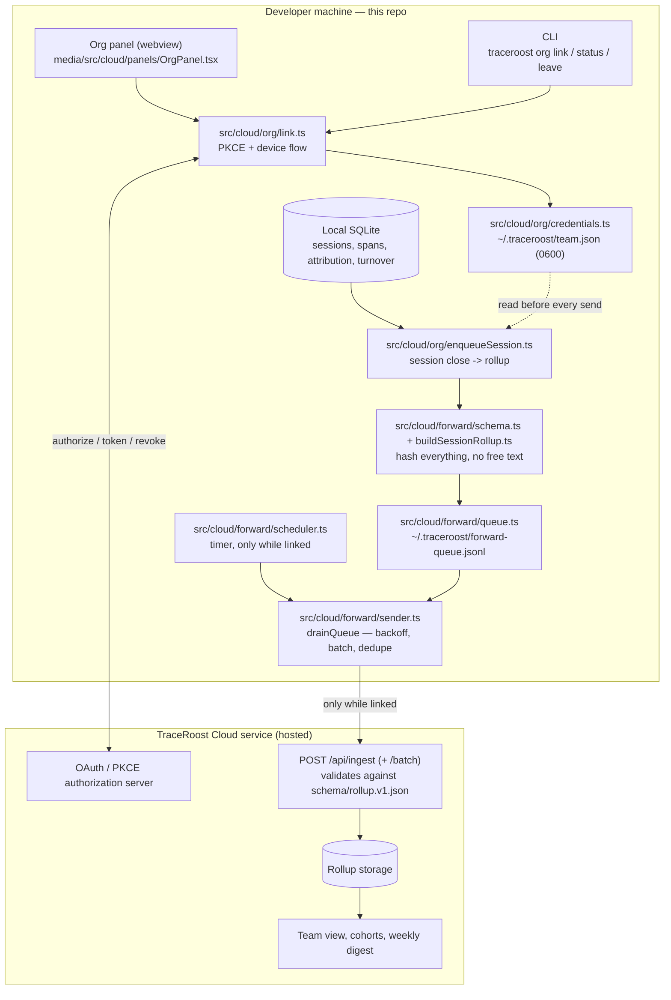

# TraceRoost Cloud — the client's interface

This document covers **only what this repository needs to know to talk to TraceRoost Cloud**:
the two rules the client is built against, the wire contract it owns, every endpoint a linked
machine calls and how each answer is handled, what a session looks like on the wire, and the
reconciliation paths (queue drain, trace manifest, on-demand backfill). It is the contract from
the machine's side.

It deliberately does **not** describe the service — its data model, entitlement, crons or
views (core is public and its docs stay core-only) — nor the client internals that aren't part
of the interface:

| For | See |
| --- | --- |
| The service itself (ingest, replace order, retirement, plans, crons, infrastructure) | TraceRoost Cloud's own documentation — not this repository |
| The module map of `src/cloud/`, the editions split, surfaces (Org panel, CLI, command palette, deep links), the free/paid boundary and the free attribution/turnover engine | [ARCHITECTURE.md §15](ARCHITECTURE.md#15-traceroost-cloud--org-link) |
| Why `src/cloud/` is one directory under its own license | [`src/cloud/README.md`](src/cloud/README.md), [`NOTICE.md`](NOTICE.md) |
| The exact wire contract | [`schema/rollup.v1.json`](schema/rollup.v1.json) |

## The two rules everything below answers to

1. **Privacy is a property, not a promise.** An unlinked install makes no request to any
   TraceRoost service, ever. The wire format has no free-text field — there is nothing for source
   code to travel in even if a bug tried to send it.
2. **The free/paid line is single-player vs. multiplayer.** Everything about *my* machine, *my*
   commits, *my* repositories is free and complete. Cloud is cross-developer aggregation — the one
   thing a local install genuinely cannot do itself. Nothing local is gated behind Cloud. (Cloud
   has its own Free plan for small teams; that is a Cloud plan, not a limit on the local install.)
   Cloud's plans and their limits are the service's business; the only one the client ever sees
   is the daily rollup ceiling, which reaches it as a `429` with `X-TraceRoost-Ceiling: daily`
   (below) — a guard that defers, never drops.

## The client owns the contract

This repo owns the wire schema; the hosted service only validates against it — never the
reverse, because the claim *"this client cannot send your code"* is only worth what it's worth
in the repository a skeptical developer already trusts.

**Reading the diagram:** everything left of the repo boundary ships in this npm package / VSIX
and is inspectable by anyone. Nothing crosses to the right unless `credentials.ts` has a saved
credential — `ENQ`, `SCHED`, and `SEND` all check that first and return before touching disk or
network otherwise. `--explain-payload` (`standalone/cloud/explainPayload.ts`) prints exactly what
`SCHEMA` would build for a real session, so the claim above is checkable without an org at all.

## Every endpoint a linked machine calls

The full list — `src/cloud/org/config.ts` names each URL. All bearer calls authenticate with the
machine's access token, and the service scopes every one of them to that token's own
org/member/install; nothing takes an org, member or install id from the request. The client
requests no OAuth `scope` — the service issues one kind of machine token and doesn't enforce
scopes, so the endpoint list below *is* what a token can do.

| Endpoint | Caller | What it's for |
| --- | --- | --- |
| `GET /oauth/authorize` → loopback callback, `POST /oauth/token` (`authorization_code`) | `link.ts` (`linkInteractive`) | PKCE link. Mints a fresh install on every link. |
| `POST /oauth/device/code`, `POST /oauth/device/token` | `link.ts` (`linkViaDevice`) | RFC 8628 flow — chosen automatically on a headless machine, or with `--device` (the Org panel's "Use a device code" button). |
| `POST /oauth/token` (`refresh_token`) | `tokenRefresh.ts` | Rotates the pair. Under the credential file's lock, re-reading it first, so two hosts on one machine never rotate the same token (the loser's `invalid_grant` would otherwise unlink the machine). Proactive when `accessTokenExpiresAt` is within a minute. |
| `POST /oauth/revoke` | `link.ts` (`leave`) | Best-effort, after the local credential and queue are already gone; also revokes the install. |
| `POST /api/ingest/batch`, `POST /api/ingest` (fallback on 404) | `sender.ts` | Rollup delivery. 401 = expired/unknown token (refresh and retry once; a transient refresh failure retries within ~30 s); 403 `{error:"install revoked"}` = stop, clear credential and queue, show a "re-link" notice — any other 403 backs off; 426 `client_upgrade_required` = pause, keep the queue, ask for an update; 400/413 drop a record only with the service's own error body; 413 = too large (split / drop); 429 = the per-install rate limit (pause for `Retry-After`, keep the queue) or, with `X-TraceRoost-Ceiling: daily`, the org's daily rollup ceiling (pause for `Retry-After` but never past midnight UTC, keep the queue, one notice per UTC day — `forwardState.ts`'s `ceiling` notice, shown in the Org panel until a send goes through); 409 `session_owned_elsewhere` (per record, only to a client sending `X-TraceRoost-Accepts: session-owner-conflict`) = another member or org already holds the session's id — re-queue it under an id salted with this org and member (`sessionRekey.ts`, ledger `~/.traceroost/rekeyed.json`, scoped by owner and kept across `leave`), which every later build, ledger check, manifest and hand-off of that session then uses; an owner id refused again is dropped, never re-salted. Bodies are gzipped (`Content-Encoding: gzip`) once large enough; a cloud that answers that with "invalid JSON" turns gzip off for good. |
| `POST /api/ingest/manifest` | `traceManifest.ts` | The trace manifest (below). 429 = wait out `Retry-After`; 5xx / network failure / anything else unexpected = back off; 400/413 = skip that day until its keys change; 401/403 as above. |
| `GET /api/roster/me` | `oauthClient.ts` (`fetchRosterSelf`) | Org name, own role (`admin`/`developer`) and email for the Org panel. |
| `GET /api/installs/me` | `traceroost org verify` | How many sessions the service holds for *this install* — compared against the local count. A re-link's backfill moves already-stored sessions to the new install, so the counts line up again. |
| `GET /api/rates/effective` | `pricingSync.ts` (hourly) | The org's own rate table (central defaults + admin overrides). Only models with a real rate are listed; anything else keeps core's local rate. |
| `GET /api/clusters/resolve` | `traceroost cluster` (`clusterResolve.ts`) | A Repeat work cluster's session ids, matched locally through the same `toUuid` the rollups use. |

What goes over `/api/ingest` today: session rollups, and per-repo instruction telemetry
(`instructionTelemetry.ts`: `instruction_files` only — each instruction file's kind, whether it
exists, its hashed path, its content hash (keyed with the repo key), line count and last-modified
time). The schema still has file footprints and suggestion events, but core no longer builds or
sends them: the service accepted and dropped both. The schema also
has commit and turnover records (`buildCommitRecords.ts`), but nothing builds and sends them yet —
which is why the consent list (`privacy.ts`, identical in both repos) doesn't promise git commit
line counts. It does list the session's own change size (below), which is a different thing.

Session rollup fields (`SessionRollup`, `schema/rollup.v1.json` `$defs/session`) beyond ids, times,
token/turn/tool/error counts, models, hashes, outcome and loop signals:

| Field | Shape | Meaning |
| --- | --- | --- |
| `agent` | `claude-code` \| `copilot` \| `codex` \| `cursor` \| `opencode` \| `other` | Which coding agent ran the session (`toWireAgent`); an agent the client doesn't know yet is `other`. Also the shape of a suggestion event's `target_agents`. |
| `data_source` | `otel` \| `log` | Where the session was read from. |
| `initiator` | `user` \| `agent` \| `api` | Who started it. |
| `conversation_hash` | sha256 | Groups the traces (turns) of one conversation. |
| `revision` | integer ≥ 1 | Replace-ordering for re-sent snapshots. Optional: absent on a first send from the rediscovery path (no revision recorded yet), which the cloud orders lowest. |
| `source_rank` | 1–3 | How much evidence the snapshot carries (3 OTEL with usage, 2 full transcript, 1 partial); a lower rank never replaces a higher one, and within a rank the newer `revision` wins. Always sent — the schema requires it. |
| `host_id` | uuid | Which TraceRoost host sent it (`src/cloud/org/hostIdentity.ts`): the extension and the standalone server share one install but each keeps its own trace store, so each has its own id — a random UUID generated once per store (`<store>/cloud-host-id`; the extension's global storage, the server's data dir), never derived from a hostname, path or anything else identifying. Lets a trace manifest retire only its own host's rows. Always sent; an unlinked preview shows a placeholder and writes no file. |
| `language` | one of `typescript` `javascript` `python` `go` `rust` `java` `csharp` `cpp` `ruby` `php` `swift` `kotlin` `dart` `shell` `sql` `html` `css` `other`, a non-code category `docs` `config` `data` `assets` (only when no code file was touched), `none` (files touched, none recognised) or `no_files` (no path recorded at all) | Primary programming language, derived locally from file extensions (`src/language.ts`). Only the id leaves the machine. Absent for sessions built before language tracking. Cloud reads an id it doesn't know yet (a newer client) as `other` rather than rejecting the session. |
| `language_secondary` | the same ids minus `none` and `no_files`, in the primary's own tier (code with code, non-code with non-code), or `null` | Runner-up language. Core omits it when only one language was touched. |
| `files_changed` | count | Distinct files the agent edited or wrote (any file type). |
| `lines_added` / `lines_removed` | count | Lines the agent's own edit/write tool calls added/removed (`src/editStats.ts`). Agent-authored edits, not git stats. Omitted when the agent's data records no edit contents. |

All of these are enums, counts or (`host_id`) a random id. No path, file name or content travels
with them, and `--explain-payload` prints a line saying so.

## One session, end to end (linked machine)

1. A session closes; `SessionStore` writes the `SessionSummaryCard` to local SQLite — unchanged
   from the free path.
2. `maybeEnqueueSession` (`src/cloud/org/enqueueSession.ts`) checks `loadCredentials()`. Unlinked →
   returns immediately, nothing else in this list runs.
3. Linked → `buildPayloadForCard` (`src/cloud/org/payloadPreview.ts`) turns the card into a
   `RollupPayload` via `buildSessionRollup.ts`: every field is a hash, enum, count, or timestamp;
   `repoKey.ts` derives the repository identifier from the local clone's root commit (HKDF/HMAC),
   never the repo name or path.
4. `ForwardQueue.enqueue()` appends it to `~/.traceroost/forward-queue.jsonl` (0600) if the
   idempotency key isn't already queued.
5. On its own timer — started only while linked — `drainQueue()` (`src/cloud/forward/sender.ts`) sends
   eligible items in batches (25 items and ~400 KiB per request to start, under the service's
   512 KiB wire cap; the batch route advertises its real limits — 50 items, 1 MiB inflated — in
   `limits`, which the sender adopts), refreshing the access token just before it expires or on a
   401, backing off
   with jitter on failure, dropping (never retrying) a 400 the schema rejects, splitting a batch
   the service answers 413 and dropping a single record that is too large on its own, pausing
   on a 429 (until `Retry-After`; the daily rollup ceiling's never past midnight UTC), and
   stopping entirely with one notice when the credential is gone for good — a 403 (the service's
   answer for a revoked install: an admin unlinked it, the member was removed, or the machine
   left) or a refresh rejected with `invalid_grant`. Both of those also **clear the queue**: every
   queued rollup was hashed with that org's salt and must never ship to the next org this machine
   links to (reconciliation re-enqueues after a re-link, hashed for the new org). `leave()` clears
   it the same way. (One exception keeps it: a refresh token presented twice with no answer at
   all — a local inference, not the cloud's word — clears the credential but holds the queue, and
   the next link keeps it only for the same org and member.)
6. A 2xx removes the item from the queue. If the service is unreachable indefinitely, the queue
   just grows (capped at 5,000 items, oldest-first eviction — logged when it happens, not silent)
   — the developer's local dashboard is completely unaffected either way.

`leave()` reverses step 2 immediately: the credential is deleted and forwarding stops **before**
the server-side token revoke is even attempted, so leaving while offline still works.

## Trace manifest (reconciliation safety net)

A trace's key can change as local evidence settles, and a client merges some traces into others
(stable trace identity), so a row already sent can stop existing locally. `traceManifest.ts` lets
the cloud retire those: one `POST /api/ingest/manifest` chunk per UTC day of the settled window
`[max(local horizon, now − 60 d), now − 10 min]`, carrying the sending host's `host_id`, the window
bounds and the trace keys that host still holds there — the same UUIDs that already travel as
`session_id`, nothing else (`$defs/trace_manifest`). The cloud retires only rows of *this install*
whose last sender was *this host* (`session.host_id`) started in that window whose key isn't listed,
and a retired key comes back only on a later send that strictly outranks its tombstone in
`(source_rank, revision)` order.

- **Who sends:** only a linked install, only the process that owns writes to its store (the standalone server's
  data-dir lock, the extension window that owns the database) once that store has finished its
  startup load. Each host sends its own: the extension and the background service share a
  credential but not their history (an OTEL-only trace lives only in the host whose collector got
  it), so each manifest names its `host_id` and can retire only rows that host sent. A row both
  hosts sent belongs to whichever sent it last.
- **When:** after a forwarding drain that leaves no session rollup queued. A full sweep on startup
  and on (re-)link; otherwise only days whose key set changed since their last successful chunk
  (`~/.traceroost/trace-manifest-<host_id>.json`, one per host, keeps a hash per day — never the
  keys). At most 120 chunks an hour per host (the cloud allows 300 per install); a 429 waits out
  `Retry-After`, a 5xx backs off.
- **Empty days:** sent with `confirm_empty` only when the store positively holds no trace there
  (not-yet-keyed ones included) inside the horizon; otherwise skipped. A day over 5,000 keys is split into
  shorter windows, never truncated.
- **Gates:** `missing_keys` (a listed key isn't delivered yet) → that day is re-sent after the queue
  drains again, with growing backoff; `empty_unconfirmed` → logged once. A reply whose
  `skipped_recent` is above zero (rows absent from the chunk's keys that the cloud left alone because
  they were ingested in the last 10 minutes — older clouds send no such field) marks the day
  _settling_: re-sent once, a little over 10 minutes later, not on the missing_keys schedule.
- **Dropped rollups:** a session rollup the cloud refused for good (a 400 or a single-record 413 —
  `sender.ts`) that it never held under any revision is recorded in `~/.traceroost/dropped.json`
  (`DroppedLedger`, scoped to the install like the delivery ledger) and left out of every manifest:
  the cloud has no row for it, and listing it would hold the day at `missing_keys` for a delivery
  that will never come. A later accepted revision of the same session clears the entry. A day whose
  every key was dropped sends nothing (the store isn't empty, so no `confirm_empty`).
- One output line per run that sent anything — chunk, retired and gated counts, never a key.
  `--explain-payload` prints the newest chunk as it would be sent.

## "Check for unsent traces" (on-demand reconcile)

The Org panel's button (also run automatically right after linking, and by `linkWatcher.ts` when
a link made outside this process — `traceroost org link` in a terminal, the other host — is
noticed) calls `reconcileLocalSessions` (`panelController.ts`) → `queueUnsentSessions`
(`reconcileUnsent.ts`), which runs steps 2–4 above for
*every* local session the host knows about, not just the one that just closed — so a newly linked
machine (or one that was offline) backfills its whole history instead of only reporting forward
from the link moment. (The log-file rediscovery on every process restart reaches step 2 for each
session on its own; the delivery ledger is what keeps that from rebuilding and resending
history.)

- **Runs a bounded 6-worker pool**, not one session at a time — `maybeEnqueueSession` calls for
  independent sessions overlap instead of fully serializing.
- **Shares one per-run cache** (`createPayloadBuildCache`, `payloadPreview.ts`) across the whole
  pool — repo-key derivation, branch lookup, and git-outcome classification are memoized per
  distinct workspace for the run's lifetime, since a developer's sessions cluster in a handful of
  repos. Nothing is cached across separate reconcile runs.
- **Sees every local session**, not capped at `MAX_SESSIONS_TO_WEBVIEW` — the VS Code host passes
  `listSessions({ limit: Infinity })` for this path specifically (`dashboardPanel.ts`).
- Once reconcile enqueues anything, `drainForwardQueueSoon()` (`scheduler.ts`) triggers a drain
  that **keeps going immediately while genuine backlog remains and nothing is stopping it** —
  instead of draining one 200-item batch and waiting up to 5 minutes for the next tick.

This was built against a reported symptom: the button hanging for minutes on a real backlog.

## Testing hooks worth knowing about

- `src/test/cloud/forward/schema.test.ts` walks `schema/rollup.v1.json` and fails the build if any
  string field is left unconstrained (no accidental free-text field).
- `src/test/cloud/org/privacy.test.ts` pins the exact `SENT` / `NEVER_SENT` lists shown on the
  consent screen.
- `standalone/cloud/explainPayload.ts` + its test assert the printed `--explain-payload` JSON equals
  what actually gets queued — the transparency claim is enforced, not just documented.
